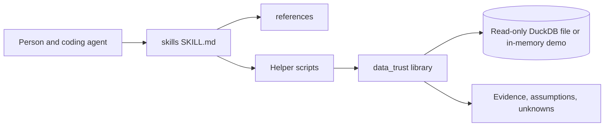

# data-trust-skills

Give your coding agent the checks to prove a dashboard number is right.

A vendor-neutral pack of agent skills for people who ship SQL, models, and dashboards and need evidence that a published number is the number they defined. The skills are `SKILL.md` folders that Claude Code, Cursor, and Codex can read. They sit next to the tools you already use. They do not replace a warehouse, a transformation project, or a semantic layer.


The image is a line-by-line playback of the `make demo` output captured for this release, so the scroll stays readable. Those figures come from a seeded synthetic dataset (seed 20260315). They are not real business data.

## Quick start

Install [uv](https://docs.astral.sh/uv/getting-started/installation/), then:

```bash
uv sync
make demo
```

`make demo` builds a seeded synthetic shop in memory, runs the buggy revenue model and the corrected one, and prints the inflation and the two root causes. The printed figures are not real business data. It does not ask for credentials and it does not call a network service.

Install notes for each client: [Claude Code](docs/install-claude-code.md), [Cursor](docs/install-cursor.md), [Codex](docs/install-codex.md).

## Sample

The input model is [`examples/broken-revenue-demo/models/buggy_revenue.sql`](examples/broken-revenue-demo/models/buggy_revenue.sql). It groups completed-order line amounts by UTC date and region, and it left-joins refunds before the sum. The reference model and the contract live beside it. The generator seed is `20260315`. Every figure below comes from that seeded synthetic dataset and is not real business data.

This is the output of `make demo` on DuckDB 2.0.0:

```text
data-trust-skills demo
seed: 20260315
engine: duckdb 2.0.0 (in memory)
metric: gross_item_revenue

dataset
  customers: 12
  orders: 34
  completed_orders: 30
  order_items: 59
  refunds: 12

buggy model
  file: examples/broken-revenue-demo/models/buggy_revenue.sql
  basic tests: pass
  basic test rules: unique order_date + region, no nulls, revenue >= 0
  sql lint: pass
  sql lint rules: no SELECT *, no CROSS JOIN, GROUP BY present

totals
  buggy: 3377.50
  correct: 3152.50
  inflation: 225.00

root cause 1: join fanout
  step: refunds_joined
  intended grain: order_item_id
  labeled relationship: many_to_one
  extra rows: 5
  extra revenue: 225.00
  counterexample:
    order_id: ord_fanout_1
    repeated order_item_id: ord_fanout_1-i1
    copies of that item: 3
    line items: ord_fanout_1-i1 qty 1 price 40.00, ord_fanout_1-i2 qty 1 price 60.00
    refund rows: 3

root cause 2: timezone boundary
  stored: UTC naive timestamp
  business timezone: America/New_York
  model date expression: CAST(ordered_at AS DATE)
  shifted line rows: 3
  revenue on shifted rows: 105.50
  shifted order: ord_tz_1 ordered_at 2024-01-15 03:30:00 model_date 2024-01-15 business_date 2024-01-14 revenue 80.00
  shifted order: ord_tz_2 ordered_at 2024-03-10 04:15:00 model_date 2024-03-10 business_date 2024-03-09 revenue 15.50
  shifted order: ord_tz_3 ordered_at 2024-07-04 03:59:00 model_date 2024-07-04 business_date 2024-07-03 revenue 10.00
  day-level revenue moved: 105.50
  the timezone bug does not change the grand total

daylight-saving scan
  repeated-hour rows: 1
  missing-hour rows: 0

reconcile orders, buggy minus correct
  difference: 225.00
  by region:
    US-East: buggy 1402.50 correct 1202.50 difference 200.00
    US-West: buggy 762.50 correct 737.50 difference 25.00
  orders with a difference:
    ord_fanout_1: buggy 300.00 correct 100.00 difference 200.00
    ord_fanout_2: buggy 50.00 correct 25.00 difference 25.00

reconcile calendar days, deduped UTC date minus America/New_York date
  total difference: 0.00
  days with a difference:
    2024-01-14: utc 0.00 business 80.00 difference -80.00
    2024-01-15: utc 80.00 business 0.00 difference 80.00
    2024-03-09: utc 0.00 business 15.50 difference -15.50
    2024-03-10: utc 15.50 business 0.00 difference 15.50
    2024-07-03: utc 0.00 business 10.00 difference -10.00
    2024-07-04: utc 10.00 business 0.00 difference 10.00

assumptions
  - The reference metric is completed-order line amounts, with no refund join, on the America/New_York date.
  - Gross item revenue does not subtract refunds.
  - Extra revenue is the refund-join sum minus one copy of each line amount.
  - Day-level revenue moved is half the sum of absolute daily differences.
  - The daylight-saving scan uses the order timestamps, padded by two days.
  - No tolerance was applied to the demo difference.
unknowns
  - none
```

The basic tests and the small SQL lint pass while the total is `225.00` too high. That gap is the refund join. The timezone bug moves `105.50` between calendar days and does not change the grand total. Order `ord_fanout_1` is the fanout counterexample: two line items and three refund rows, so each item is summed three times (`300.00` instead of `100.00`).

## Architecture



One `skills/` directory is the source. Claude Code reads it through the plugin manifest. Cursor is pointed at it by a rule. Codex sees it only after a symlink into `.agents/skills/`. The helpers share a small Python library and refuse SQL that is not a single `SELECT` or `WITH`.

## Skills

| Skill | Question it answers |
| --- | --- |
| [verify-grain-and-joins](skills/verify-grain-and-joins/SKILL.md) | Is this one row per entity, and did a join add or drop rows? |
| [reconcile-metric-values](skills/reconcile-metric-values/SKILL.md) | Why do these two calculations of the same metric differ? |
| [test-time-semantics](skills/test-time-semantics/SKILL.md) | Did a timezone, period end, late row, or fiscal calendar move the number? |
| [define-metric-contract](skills/define-metric-contract/SKILL.md) | What is the metric, who owns it, and how close is close enough? |

## Results

`make demo` produced the totals above from the seeded synthetic dataset, not from real business data: buggy `3377.50`, correct `3152.50`, inflation `225.00`, day-level movement `105.50`.

`uv run python evals/run_evals.py` checks the helper scripts against ten broken fixtures. It does not call a model. This is the output from this release:

```text
contract-missing-owner pass
dropped-inner-join pass
dst-gap pass
fiscal-versus-calendar pass
inclusive-period-end pass
late-arrivals pass
mixed-grain pass
reconcile-segment-gap pass
refund-join-fanout pass
timezone-day-shift pass
10 passed, 0 failed
```

The [rubric](evals/rubric.md) says how a future agent reply should be scored. The harness is [evals/agent-comparison/](evals/agent-comparison/README.md). With-skill versus without-skill agent comparisons were not run: every client CLI installed here stopped at login, so the result file is pending and has no scores.

## Limitations

- The grain helper does not parse a query into a join graph. You pass the steps.
- Time conversions were executed on DuckDB 2.0.0. A `timestamptz` column is not a supported storage mode. Another engine can treat `AT TIME ZONE` differently.
- The read-only guard is a keyword filter. It is not a database privilege.
- Copying a single `SKILL.md` out of the repo does not bring a working helper. The scripts import `src/data_trust`.
- dbt projects, Snowflake worksheets, and dashboard products were not invoked. The questions apply to SQL from those tools; this release only ran DuckDB.
- CI checks relative links. It does not re-fetch documentation URLs.
- GitHub's hosted secret scanning is a repository setting. This repo runs gitleaks 8.30.1 in CI instead of changing that setting.
- The gif at the top is a line-by-line playback of captured `make demo` output, not a hand-typed session.

## Compatibility

Checked in this release means a file or a command that was actually run here. A product session means opening that product and loading the skill.

| Check | Claude Code | Cursor | Codex |
| --- | --- | --- | --- |
| `SKILL.md` name, description, and relative links validated | yes | yes | yes |
| CLI binary started in this environment | yes, 2.1.319 | yes, cursor-agent 2026.11.05-86047df | yes, codex-cli 0.167.0 |
| Logged in | no | no | no |
| Live skill trigger | not run (no credentials) | not run (no credentials) | not run (no credentials) |

Cursor's rule file is in the tree and matches the documented frontmatter (`description` set, `alwaysApply: false`, no `globs`). That file check is not a live session. The prompt used for the trigger attempt was: "Revenue on this dashboard looks too high. Check the model in examples/broken-revenue-demo." Raw transcripts are in [evals/agent-comparison/transcripts/](evals/agent-comparison/transcripts/cursor-agent-probe.txt).

## Contributing

See [CONTRIBUTING.md](CONTRIBUTING.md). Please keep new data synthetic and new writing original.

## Roadmap

Not in this release:

- `review-sql-correctness` — read a query for filter, join, and aggregation mistakes before it is merged.
- `design-data-quality-checks` — turn a metric contract into concrete data checks.
- `verify-incremental-equivalence` — compare an incremental build with a full refresh of the same model.
- `verify-semantic-parity` — compare a semantic-layer metric with the warehouse SQL it claims to match.
- `qa-dashboard-behavior` — check filters, totals, and drill paths on a dashboard.
- `assess-change-impact` — list published metrics a schema or model change can move.
- A with-skill versus without-skill agent comparison, scored with the rubric. The harness is in the tree. Those comparisons were not run.

## License

[MIT](LICENSE).

dbt, Snowflake, DuckDB, and the other product names in these notes are trademarks of their owners. This is an independent project.

Author: [saliaaa](https://github.com/saliaaa) · [@levan_salia](https://x.com/levan_salia)
